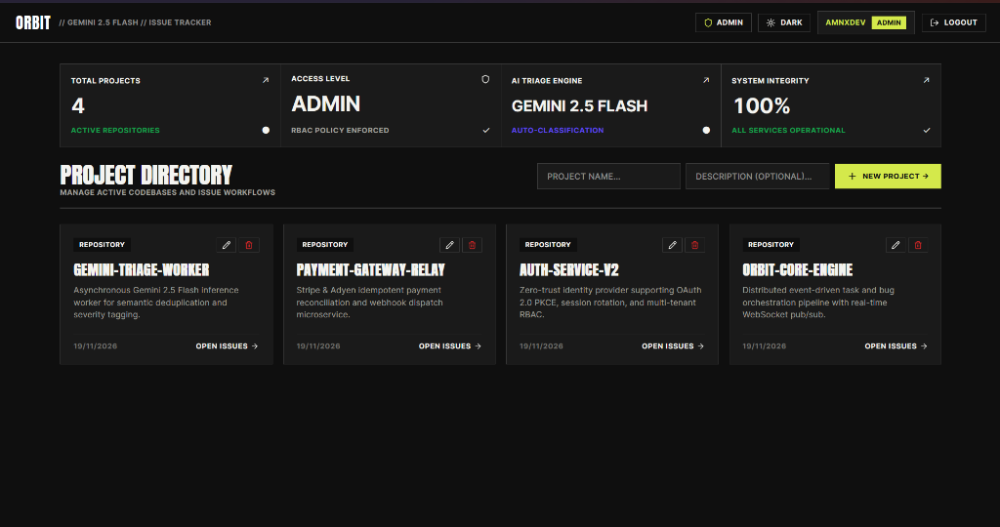
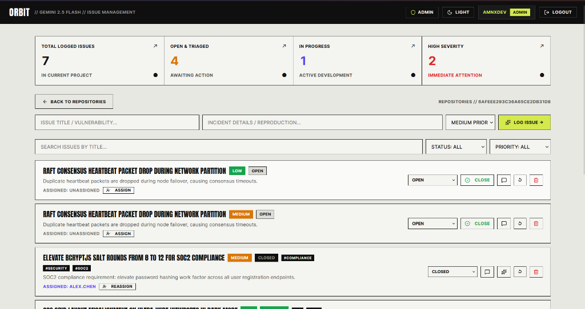
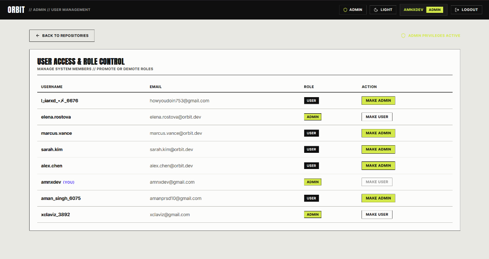

# ORBIT — Issue & Bug Tracker

ORBIT is a full-stack, Neo-Brutalist issue and bug tracking platform built on the MERN stack (MongoDB, Express, React 19, Node.js ES modules) with Role-Based Access Control (RBAC) and automated AI triage. When a bug is logged, ORBIT runs Google Gemini (`gemini-2.5-flash`) in parallel to suggest severity priority, refine descriptions, generate tags, and detect potential duplicate issues, while enforcing strict ownership and role-based permissions across projects, bugs, comments, and user administration.

---

## Live Demo

- **Frontend (Vercel):** https://orbit-fontend.vercel.app
- **Backend API (Render):** https://orbit-backend-i2rz.onrender.com

> **Note:** The backend runs on Render's free tier and may take up to ~50 seconds to wake up on the first request after inactivity.

---

## Screenshots

### 1. Project Directory & KPI Dashboard (Dark Theme)


### 2. Issue List, Client-Side Filters & AI Triage


### 3. Admin User & Role Management (`/admin`)


---

## Features

- **Authentication & Sessions:** Email/password registration and login (`bcryptjs` + `jsonwebtoken` 1-day JWT) plus Google OAuth 2.0 (`passport-google-oauth20`), with persistent `localStorage` + React Context session state.
- **Role-Based Access Control (RBAC):**
  - Backend `verifyToken`, `requireRole(...roles)`, and `canModifyBug(user, bug)` enforcement.
  - Frontend role badges (`ADMIN` / `USER`), protected `/admin` route, role-scoped UI controls, and a global HTTP 403 Forbidden error banner.
- **Project Management:** View all projects, and (for admins) create, edit, and delete projects.
- **Bug Lifecycle & Assignment:** Create bugs, edit details, track 4-tier status (`open`, `in-progress`, `resolved`, `closed`) and priority (`low`, `medium`, `high`), assign developers (admin-only), and cascade-delete bugs with their comments.
- **Gemini AI Triage & Duplicate Detection:** Automatically classifies priority, refines descriptions, extracts tags, and flags near-duplicate bugs on creation, with on-demand re-triage (`POST /api/bugs/:id/retriage`).
- **Threaded Discussions:** Post and delete comments on individual bugs.
- **Client-Side Filtering:** Filter bugs instantaneously by Status, Priority, and Title search query.
- **Admin User Management (`/admin`):** View all users (without password hashes) and promote/demote roles (`PUT /api/users/:id/role`) with self-demotion prevention.
- **Resilient UX States:** Mono `LOADING...` indicators with a 5-second cold-start wake notice, empty states, inline error banners, and disabled submit buttons during in-flight requests.

---

## Tech Stack

| Layer | Technology |
| :--- | :--- |
| **Frontend** | React 19, Vite, React Router, Axios, Lucide React |
| **Styling** | Custom Neo-Brutalist CSS (`0px` radius, `1px` borders, no shadows, CSS variables) |
| **Backend** | Node.js (ES Modules), Express 5 |
| **Database** | MongoDB Atlas, Mongoose |
| **Auth & Security** | JSON Web Tokens (`jsonwebtoken`), `bcryptjs`, Passport (`passport-google-oauth20`) |
| **AI Engine** | Google Gemini API (`@google/genai`, `gemini-2.5-flash`) |

---

## Roles & Permissions

| Action / Route | `user` | `admin` |
| :--- | :---: | :---: |
| Register / Login / View Projects | Yes | Yes |
| Create / Edit / Delete Projects | No | Yes |
| Create Bugs & Post Comments | Yes | Yes |
| Update Bug Details / Status | Creator or Assignee only | Any bug |
| Set Bug Status to `closed` | Creator only | Any bug |
| Delete Bug (and its Comments) | Creator only | Any bug |
| Assign / Reassign Developer (`PUT /api/bugs/:id/assign`) | No (`403 Forbidden`) | Yes |
| View User Directory (`GET /api/users`) | Yes (no passwords) | Yes (no passwords) |
| Access `/admin` & Change User Roles (`PUT /api/users/:id/role`) | No (redirected to `/`) | Yes (cannot self-demote) |

---

## Local Setup

### 1. Clone the repository
```bash
git clone https://github.com/amnxdev/bug-tracker.git
cd bug-tracker
```

### 2. Configure Environment Variables

Create `server/.env` with the following variable names (no values included here):

- `PORT`
- `MONGO_URI`
- `JWT_SECRET`
- `CLIENT_URL`
- `SERVER_URL`
- `GEMINI_API_KEY`
- `GEMINI_MODEL`
- `GOOGLE_CLIENT_ID`
- `GOOGLE_CLIENT_SECRET`

Create `client/.env` with:

- `VITE_API_URL`

### 3. Install Dependencies & Seed Database

```bash
# Backend
cd server
npm install
npm run seed
npm run dev
```

```bash
# Frontend (in a new terminal)
cd client
npm install
npm run dev
```

Open `http://localhost:5173` in your browser.

---

## Demo Credentials

Running `npm run seed` in `server/` resets the database and creates `"Demo App"` with 8 sample bugs, 3 comments, and the following accounts:

| Role | Email | Password |
| :--- | :--- | :--- |
| **Admin** | `admin@orbit.dev` | `Demo@1234` |
| **User** | `user@orbit.dev` | `Demo@1234` |

---

## Known Limitations

- **Free-Tier Cold Starts:** When hosted on Render's free tier, the backend spins down after inactivity, causing initial API requests to take up to ~50 seconds.
- **Client-Side Pagination & Filtering:** `GET /api/projects/:projectId/bugs` fetches all bugs for a project and filters them in browser memory, which may slow down for repositories with thousands of issues.
- **AI Triage Availability:** Automated triage and duplicate detection require a valid `GEMINI_API_KEY` with available quota; if unavailable, ORBIT falls back to default medium priority without AI tags.
